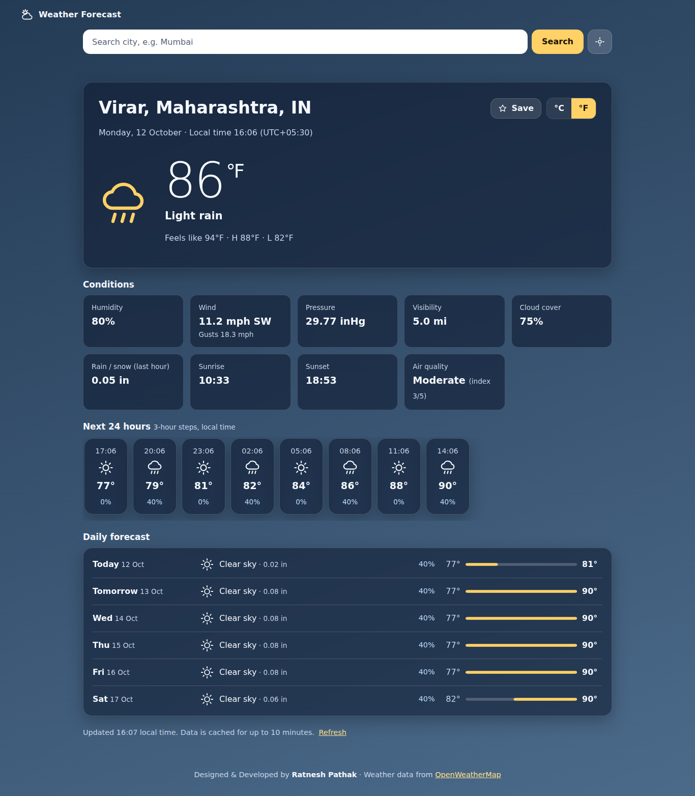
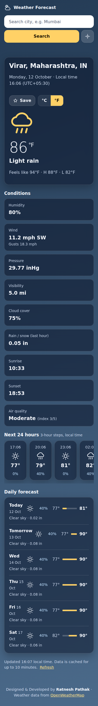

# 🌦️ Weather Forecast App — UI Showcase

A modern, responsive weather forecasting interface designed and developed by Ratnesh Pathak. The application is built with Flask, Python, HTML, CSS, and JavaScript, with weather information powered by the OpenWeatherMap API.

This repository presents the project's documentation and UI screenshots. It does not contain the runnable application source code.

## 🖥️ Desktop Preview

## 📱 Mobile Preview

> **Screenshot note:** The displayed weather values use simulated API data. They are UI previews, not real-time forecasts.

## ✨ Features

- City search with autocomplete
- Current weather conditions and temperature
- 24-hour outlook with three-hour forecast intervals
- Multi-day weather forecast
- Celsius and Fahrenheit conversion
- Favorite locations and recent searches
- Optional browser-based current location
- Weather-aware day and night backgrounds
- Responsive desktop and mobile layouts
- Accessible controls and keyboard navigation
- Loading, error, and missing-data states

## 🛠️ Technology Stack

- Python and Flask
- HTML5 and Jinja templates
- CSS3
- Vanilla JavaScript
- OpenWeatherMap API

## 🔒 API and Privacy

The original application uses an OpenWeatherMap API key configured on the server. Never publish a real API key or secret in this showcase.

## 📄 License

See the `LICENSE` file for the applicable license terms.

## 👨‍💻 Developer

**Ratnesh Pathak**

GitHub: [@RatneshPathak](https://github.com/RatneshPathak)

---

*An independent weather forecasting project created for learning, development, and portfolio demonstration.*